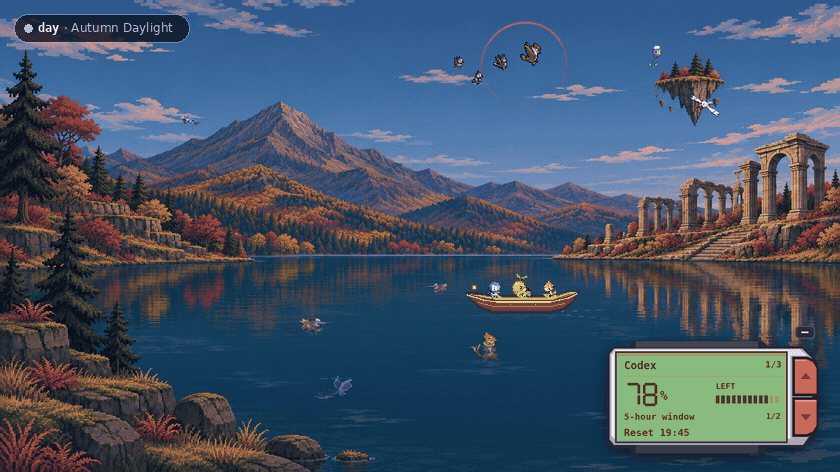
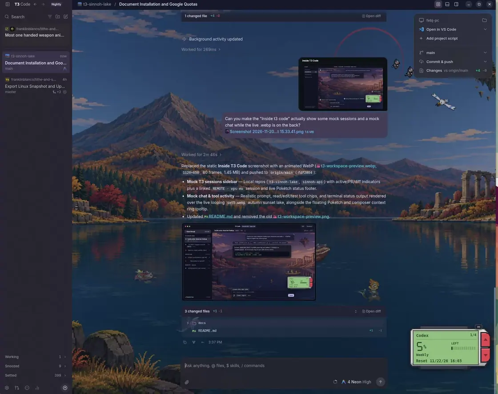
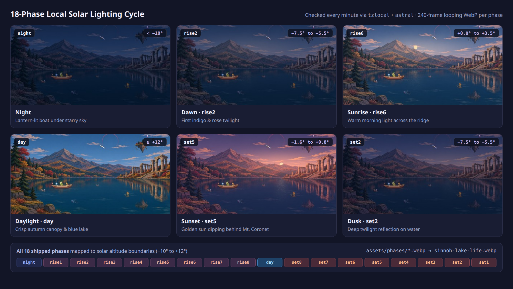
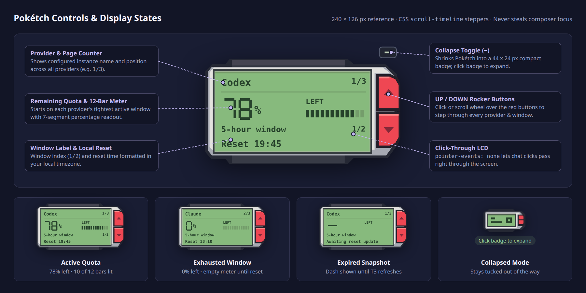
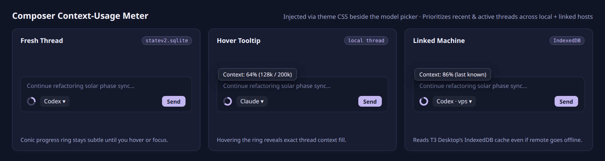
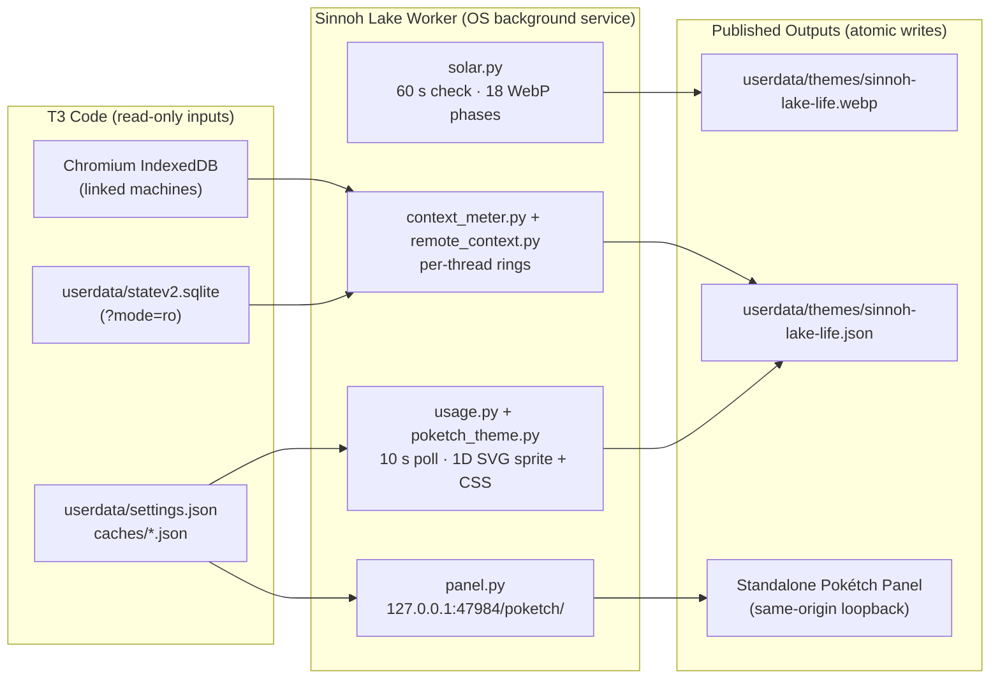

# T3 Sinnoh Lake

Sinnoh Rift · Lake Life brings an animated autumn pixel-art lake to the T3 Code conversation pane. Submerged Magikarp, Buizel and Finneon glide beneath the surface; Starly, Staravia and Staraptor fly in formation while Wingull, Zubat and Drifloon follow their own paths; and Turtwig, Chimchar and Piplup cruise past in a wooden boat. **Pokétch** is a green LCD quota monitor that floats over the conversation inside T3 Desktop.

## Inside T3 Code

## Living Sinnoh Lake & Solar Phases

The solar clock checks your local time zone once a minute (`tzlocal` + `astral`) and swaps in one of 18 prebuilt 240-frame looping WebP animations (`night`, `rise1`–`rise8`, `day`, `set8`–`set1`) based on solar altitude at the zone’s representative city. T3 reloads the updated background atomically from its watched theme directory.

<strong>Live animated daylight loop</strong> (<code>assets/phases/day.webp</code>)

 

### Lake Wildlife Cast

| Boat Crew | Swimmers | Sky Flock |
| :---: | :---: | :---: |
|    **Turtwig · Chimchar · Piplup** |    **Magikarp · Buizel · Finneon** |    **Wingull · Zubat · Drifloon** + **Starly / Staravia / Staraptor** |

## Pokétch in Chat

Select **Sinnoh Rift · Lake Life** in **Settings → Appearance**. Pokétch appears as soon as T3 renders any existing chat or new draft, including chats on linked environments. It hides on non-chat screens and when the T3 window is minimized or closed. Clicks over the LCD pass straight through to the chat beneath it (`pointer-events: none`), and clicking the red buttons or collapse toggle never steals focus from the chat composer.

- **Position & scale:** Floats 14 px from the right edge and 90 px from the bottom of the T3 viewport (`240 × 126 px` reference size), scaling smoothly with the window.
- **Controls:** Click the red **UP** and **DOWN** buttons (or scroll over them) to step through every configured provider instance and reported quota window. Click the **−** pill above the top-right edge to collapse Pokétch into a compact badge, and click the badge to expand it again.
- **Readout rules:** **LEFT** and the 12-bar meter show remaining quota, starting on each provider’s tightest valid window with reset times in your local time zone. Expired snapshots display **Awaiting reset update**, unknown quota shows a dash, and an exhausted window shows **0%** with an empty meter.
- **Renderer-safe CSS & standalone fallback:** In-chat controls use CSS `scroll-timeline` driven by non-focusable `::-webkit-scrollbar-button` steppers (avoiding Chromium’s `::scroll-marker` / `::scroll-button()` crash) and were tested in T3 Nightly `0.1.11-nightly.20261118.4890`. The standalone panel also remains available at the installer’s IPv4 loopback URL (`http://127.0.0.1:47984/poketch/`) in T3’s **Browser** panel or any browser tab; legacy floating tabs on that URL are hidden automatically while keeping docked tabs untouched. [T3 theme CSS documentation](https://github.com/pingdotgg/t3code/blob/8cf97b5f06f30a872ce30ab8a888f2ff012365a2/docs/user/appearance.md#custom-css)

## Composer Context Meter

Hover over the ring to the left of the composer’s model picker to see the active thread’s context percentage. Linked machines use the latest reading T3 Desktop received (including last-known data if a remote host goes offline), prioritizing recent and active threads within T3’s 100 KB theme CSS limit.

## How It Works

The worker never mutates T3 state: it only reads local configuration/caches and atomically writes theme assets under `<t3_home>/userdata/themes/`. Because quota display values live in the published theme, theme exports and clients following that environment theme inherit the readout automatically.

## Install

Use Python 3.11–3.14 with `venv`, `pip` and Git. Run the installer as the signed-in desktop user with T3 Code open. On an existing setup, pass `--keep-theme` to preserve the selected theme.

| Desktop | Install command | Startup and migration |
| --- | --- | --- |
| Windows 10/11 | `py -3.12 install.py --keep-theme` | Task Scheduler runs the background worker in the current user’s interactive session. The installer verifies the owner and action of the existing **T3 Sinnoh Lake** task before restarting it with the new launcher. |
| Linux | `python3 install.py --keep-theme` | A per-user `systemd` service (`t3-sinnoh-lake.service`) keeps the background worker running outside the installer’s shell cgroup and restarts it on failure, archiving any owned legacy XDG autostart `.desktop` entry. Falls back to XDG autostart when `systemd --user` is unavailable. Works on X11 and Wayland. |
| macOS | `python3 install.py --keep-theme` | A per-user LaunchAgent starts the background worker. Once it responds, the installer stops legacy clock and floating overlay jobs and archives their plists under `legacy/`. |

On a fresh install, omit `--keep-theme` to select **Sinnoh Rift · Lake Life** through `t3 theme set`. If the CLI is unavailable, select it in **Settings → Appearance**. The static **Sinnoh Rift** variant is also available. Existing theme definitions and custom CSS are kept.

The default T3 data directory is `~/.t3`. Set `T3CODE_HOME` or pass `--t3-home PATH` for a custom directory. The installer prints the panel URL; if the default port (`47984`) is occupied, pass `--port PORT` and use the printed URL.

## Verify and Rebuild

Run `python -m sinnoh.solar --status` with the installed environment to check the time zone and phase. Use `t3 theme show` to inspect the environment theme. Check `monitor.log` in the installed directory if the Browser cannot connect.

| Desktop | Install directory |
| --- | --- |
| Windows | `%LOCALAPPDATA%\T3 Sinnoh Lake` |
| Linux | `${XDG_DATA_HOME:-~/.local/share}/t3-sinnoh-lake` |
| macOS | `~/Library/Application Support/T3 Sinnoh Lake` |

To run the tests, install `requirements.txt` and `Pillow==13.0.0`, then run `python -m unittest discover -s tests -v` and `node --test tests/poketch.test.mjs`. For the optional Chromium layout test, install Playwright and its Chromium build, then run `node tests/poketch-browser.mjs`. The desktop installer does not require Node.

The shipped animations are ready to use. To rebuild a phase, install `artwork/requirements.txt` and run `python artwork/build.py day` (other keys: `night`, `rise1`–`rise8`, `set1`–`set8`). For attribution, see [CREDITS.md](CREDITS.md).
